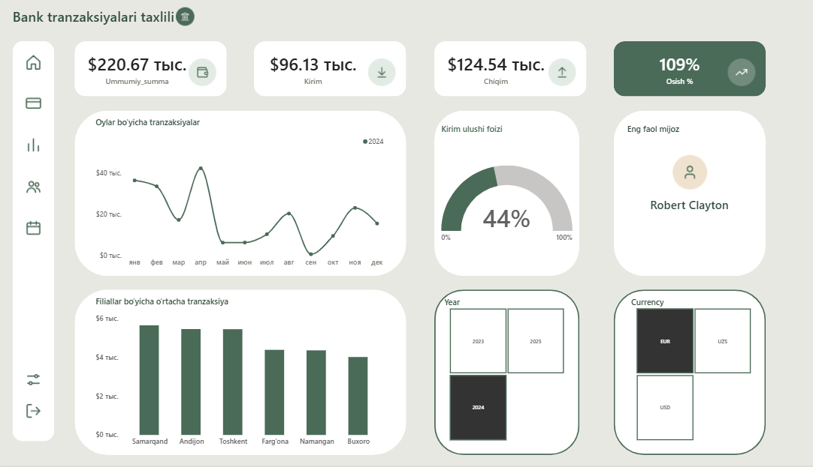

# Bank Transactions Dashboard (Power BI)

Power BI dashboard that analyzes bank transactions: inflow and outflow, net amount, year-over-year growth, and top customer. Built with DAX measures on top of a transactions dataset.



## Tools
- Power BI Desktop
- DAX
- Excel (source data)

## Dataset
`Bank_Transactions_PowerBI.xlsx` contains bank transactions with these key fields:

| Field | Description |
|---|---|
| Amount | Transaction amount |
| TransactionType | `Kirim` (inflow) or `Chiqim` (outflow) |
| CustomerName | Customer who made the transaction |
| TransactionDate | Date of the transaction |

A separate `Calendar` date table is used for time intelligence.

## DAX Measures

| Measure | What it calculates |
|---|---|
| `Ummumiy_summa` | Total transaction amount |
| `Kirim` | Total inflow |
| `Chiqim` | Total outflow |
| `Summa_belgi` | Net amount (inflow minus outflow) |
| `Kirim_ulushi` | Inflow share of the total amount |
| `Ortacha_tranzaksiya` | Average transaction amount |
| `Otgan_yili_summasi` | Total amount for the same period last year |
| `Osish %` | Year-over-year growth |
| `Oxirgi_sana` | Date of the latest transaction |
| `Eng_faol_mijoz` | Customer with the highest total transaction amount |

```dax
Ummumiy_summa = SUM(bank_tranzaksiya[Amount])

Kirim = CALCULATE(SUM(bank_tranzaksiya[Amount]), bank_tranzaksiya[TransactionType] = "Kirim")

Chiqim = CALCULATE(SUM(bank_tranzaksiya[Amount]), bank_tranzaksiya[TransactionType] = "Chiqim")

Summa_belgi = [Kirim] - [Chiqim]

Kirim_ulushi = DIVIDE([Kirim], [Ummumiy_summa])

Ortacha_tranzaksiya = AVERAGE(bank_tranzaksiya[Amount])

Otgan_yili_summasi = CALCULATE([Ummumiy_summa], SAMEPERIODLASTYEAR('Calendar'[Date]))

Osish % = DIVIDE([Ummumiy_summa] - [Otgan_yili_summasi], [Otgan_yili_summasi])

Oxirgi_sana = MAX(bank_tranzaksiya[TransactionDate])

Eng_faol_mijoz =
VAR top1 = TOPN(1, VALUES(bank_tranzaksiya[CustomerName]), [Ummumiy_summa], DESC)
RETURN CONCATENATEX(top1, bank_tranzaksiya[CustomerName], ", ")
```

## Files
- `bank tranzaksiya diplom ishi.pbix`: Power BI project (open with Power BI Desktop)
- `Bank_Transactions_PowerBI.xlsx`: source data
- `dashboard.png`: dashboard screenshot

## Skills demonstrated
Data modeling, DAX (CALCULATE, TOPN, time intelligence), KPI design, dashboard design.
